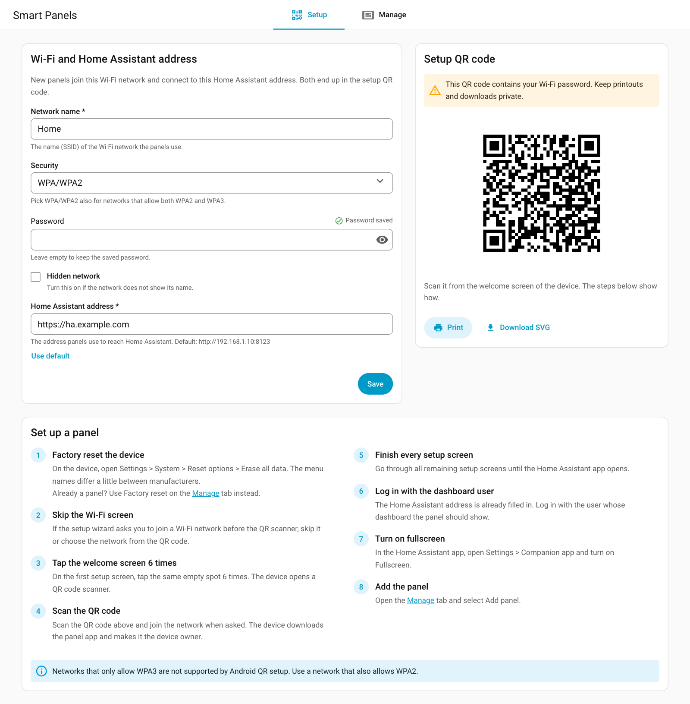
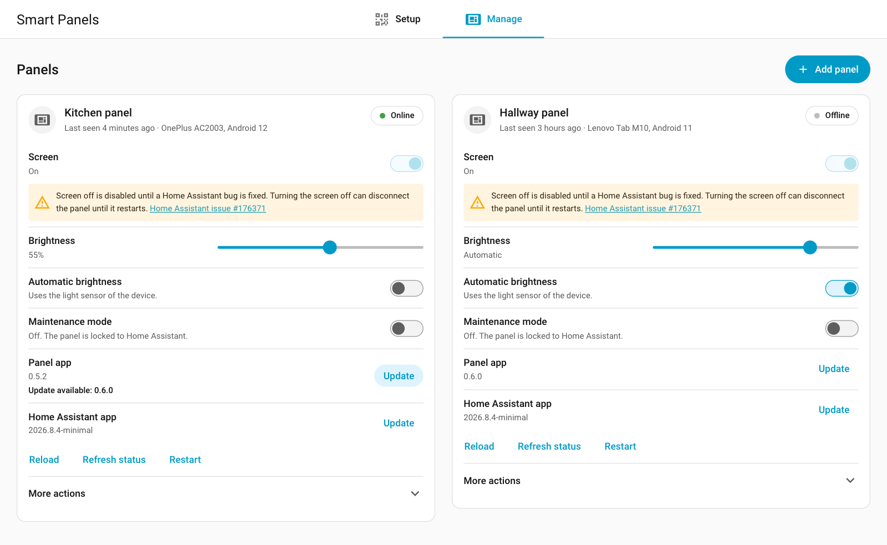

# Smart Panel

[](https://buymeacoffee.com/yepzdk)

Turn old Android phones and tablets into Home Assistant wall panels, and manage
them from Home Assistant.

The panels run the [HA Panel DPC](https://github.com/yepzdk/ha-panel-dpc), a
small device-owner app that installs the Home Assistant Companion app and pins
it fullscreen. This integration is the Home Assistant side:

- **Setup**: enter the Wi-Fi details once and get the provisioning QR code to
  scan on a factory-reset device, with a step-by-step guide.
- **Manage**: see every panel's status and send it commands in a click: screen
  on (screen off is temporarily disabled, see the Screen entity below),
  brightness, reload, open a page, maintenance mode, restart, app updates, and
  factory reset.
- **Automations**: each panel is a device with entities and actions.





Screenshots show example data; the QR code in them is not a setup code.

## Status

**0.1 — in testing.** Not yet in the HACS default store.

## Requirements

- Home Assistant 2026.9 or newer.
- Panels running the HA Panel DPC 0.6.0 or newer. Older panels receive
  commands but cannot report their status; update them first with
  **Update** under *Panel app* on the Manage tab.
- The Home Assistant address you enter must be reachable from where the
  panels are; panels report their status there. Use `https://` unless the
  address is local: `http://` is only accepted for a private, loopback or
  link-local IP address, `localhost`, or a `.local` or `.home.arpa` name. See
  [Panels away from home](#panels-away-from-home).

## Installation

HACS: add `https://github.com/yepzdk/ha-smart-panel` as a custom repository of
type *Integration*, install **Smart Panel**, and restart Home Assistant.

Manual: copy `custom_components/smart_panel` into your `custom_components/`
folder and restart.

Then add it under **Settings → Devices & services → Add integration → Smart
Panel**. **Smart Panels** appears in the sidebar for administrators.

## Enrolling a panel

1. On the **Setup** tab, enter the Wi-Fi network the panel joins and the Home
   Assistant address. The QR code updates when you save. It contains the
   Wi-Fi password, so treat a printout like the password.
2. Factory reset the device. If the setup wizard asks you to join a Wi-Fi
   network before the QR scanner, skip it or choose the network from the QR
   code.
3. On the welcome screen, tap the same spot six times, scan the QR code, and
   finish every setup screen.
4. The Home Assistant app opens at your address. Log in with the user the
   panel should use, and enable **Fullscreen** under Settings → Companion app.
5. On the **Manage** tab, choose **Add panel** and pick the new registration.
   Panels run the minimal Home Assistant app, so they are marked and listed
   first.

WPA3-only networks cannot be used: Android's QR provisioning supports WPA/WPA2
and WPA2/WPA3 mixed networks only.

### Logging in without a password

The app cannot be given a username and password from outside. To skip the
password on panels, Home Assistant's own
[trusted networks](https://www.home-assistant.io/docs/authentication/providers/#trusted-networks)
login can map the panels' fixed IP addresses to the panel user. Anyone using
such an address is logged in as that user, and behind a reverse proxy the
proxy must be listed in `trusted_proxies`.

## Panels away from home

A panel does not have to be on the same network as Home Assistant, for
example in a vacation home, on a boat or at the office:

- Enter an `https://` Home Assistant address that is reachable from where the
  panel is, for example your external URL.
- The Companion app on the panel must be able to reach Home Assistant's
  external URL, since commands reach the panel through it.
- The QR code and the status address contain the webhook id, which is the
  secret that lets a panel report its status. Keep printed QR codes private.

## Entities and actions

Each panel is a device with:

| Entity | What it does |
|---|---|
| Screen | Switch: shows whether the screen is on. Turning it off is disabled until [Home Assistant issue 176371](https://github.com/home-assistant/core/issues/176371) is fixed; turning it on still works |
| Brightness | Number, 0–255 |
| Automatic brightness | Switch: hand brightness to the light sensor |
| Maintenance mode | Switch: unpins the app and enables the status bar until turned off or the panel restarts |
| Reload | Button: loads the dashboard fresh |
| Restart | Button |
| Reinstall Home Assistant app | Button |
| Panel app | Update: installed and latest version of the panel app |
| Connectivity | Online when the panel reported within 35 minutes |
| Home Assistant app version, Last seen | Diagnostic sensors |

While a panel is offline only Connectivity, Last seen and the buttons are
available; the other entities come back with its next report. The last report
and its time are kept across Home Assistant restarts.

Actions:

- `smart_panel.navigate`: open a page on a panel, for example
  `/lovelace/kitchen` or `/profile`.
- `smart_panel.factory_reset`: erase a panel. Requires `confirm: true`.

## Development

Backend tests (Python 3.14, [uv](https://docs.astral.sh/uv/)):

```sh
uv run pytest
uv run ruff check . && uv run ruff format --check custom_components tests
```

Sidebar page (Lit + TypeScript, bundled with esbuild). The built
`custom_components/smart_panel/frontend/smart-panel.js` is committed, so
installs need no build step. Rebuild it after any change in `frontend/src`:

```sh
cd frontend
npm ci
npm run typecheck
npm run build
```

## Support

Smart Panel is free and open source. If it gave an old phone a second life on
your wall, you can [buy me a coffee](https://buymeacoffee.com/yepzdk).

## License

MIT
